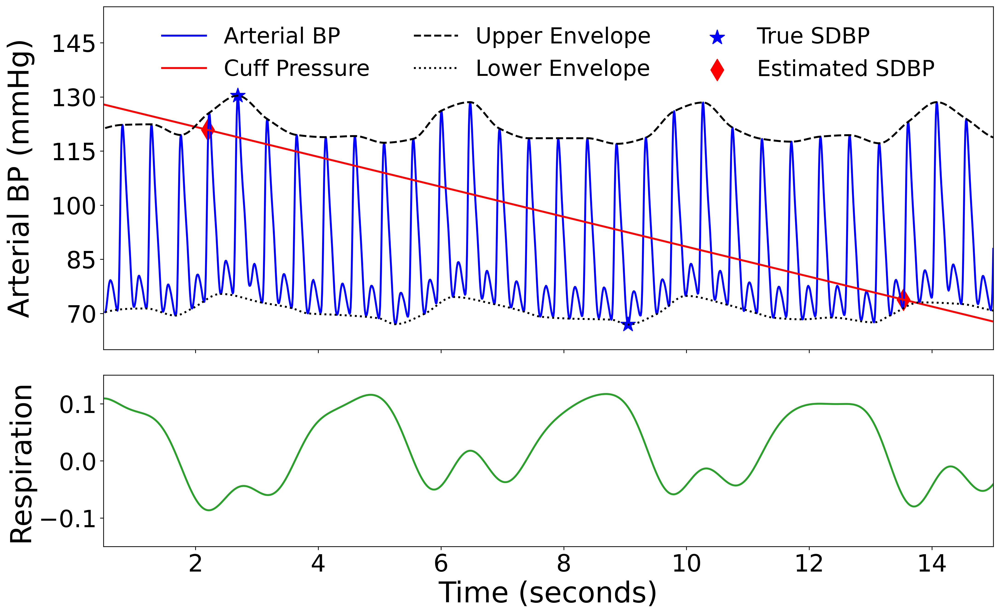
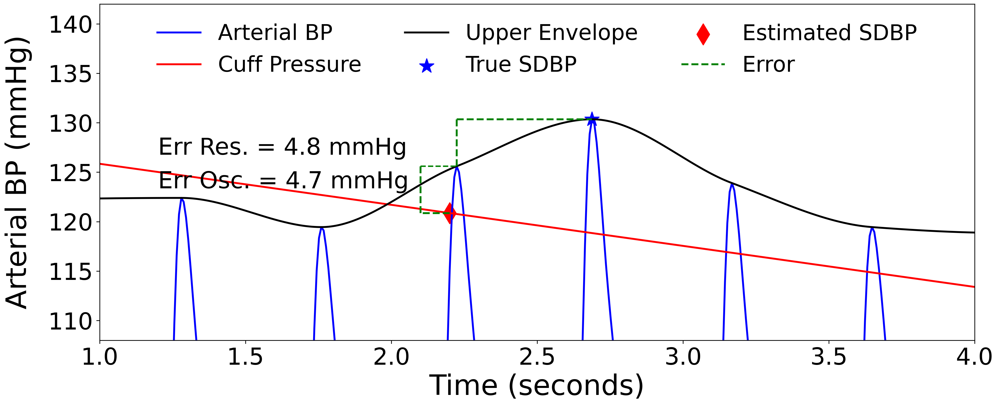
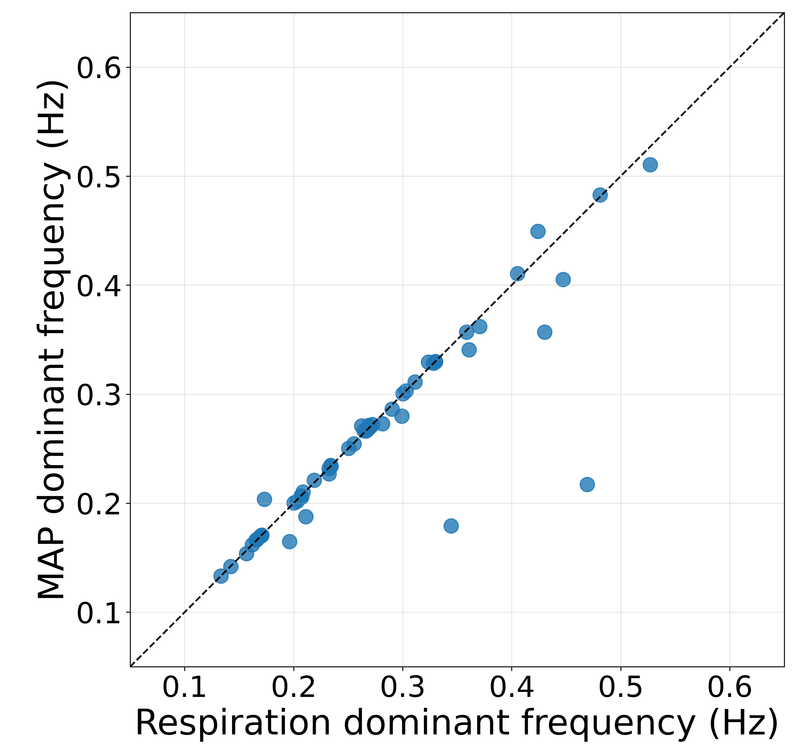
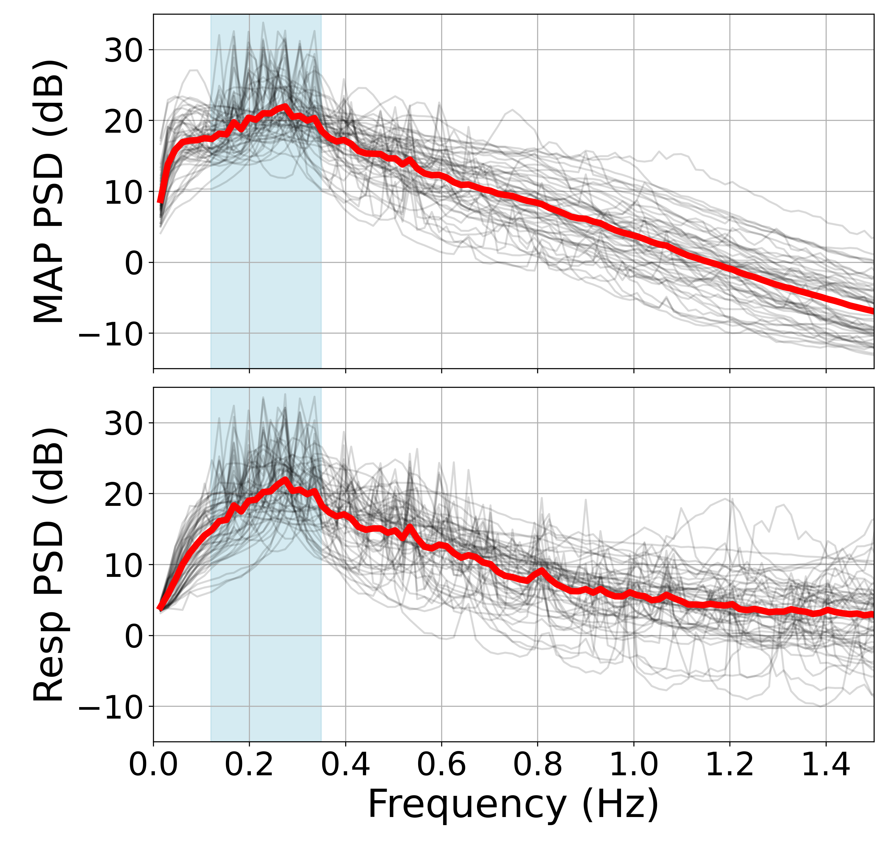
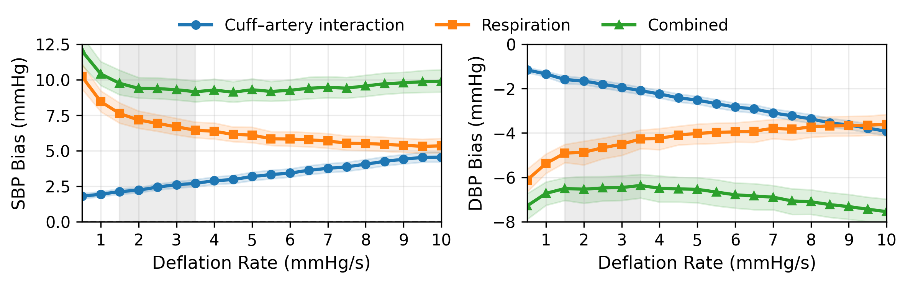
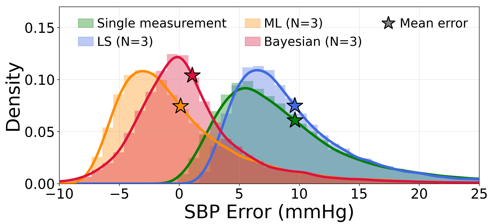
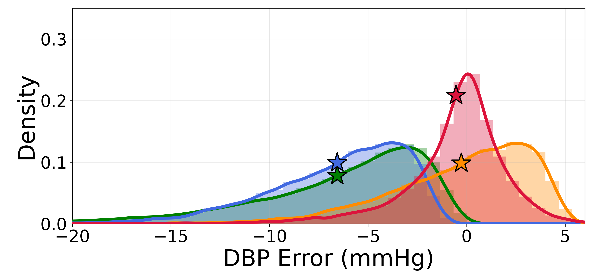
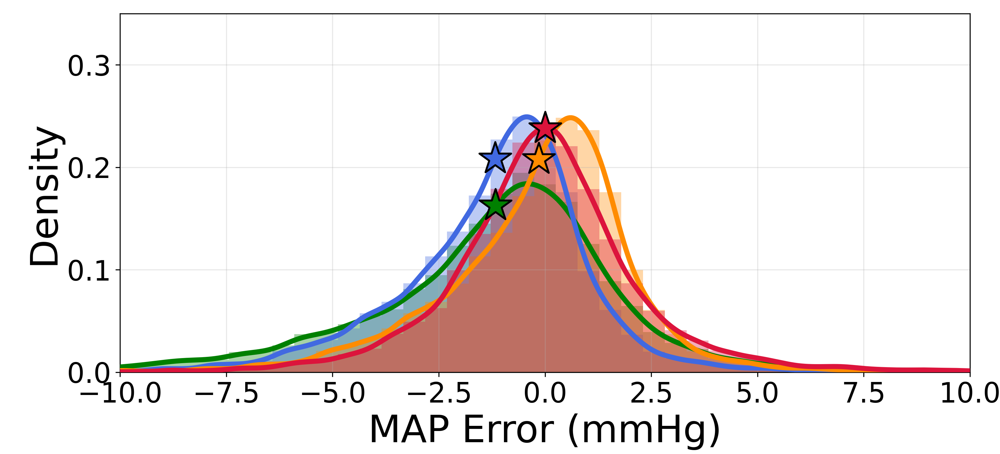
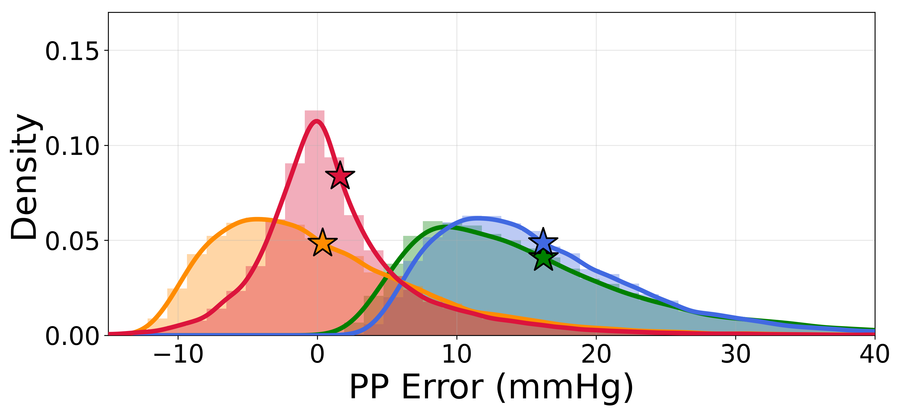
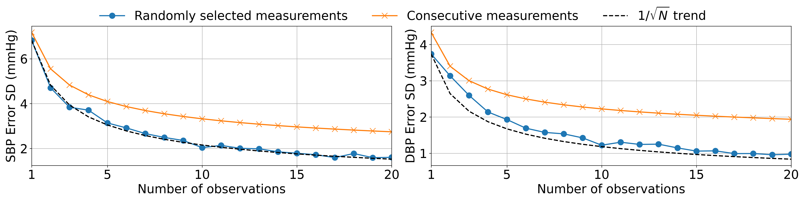

# Model-based Bias Correction for Cuff-Based Blood-Pressure Measurements
[](https://doi.org/10.1088/1361-6579/aebde2)


This repository provides the Python implementation of the  bias-correction frameworks developed for correcting systematic biases in conventional cuff-based blood pressure (BP) measurements.

The study investigates two systematic sources of error in cuff-based BP measurements: **respiration-induced BP variability** and **systematic biases introduced by the cuff-based measurement technique**.

To address these errors, three estimation frameworks are investigated:

- **Least Squares (LS):** Reduces measurement variability by averaging multiple observations without explicitly correcting systematic bias.
- **Maximum Likelihood (ML):** Uses the statistical properties of measurement errors to correct systematic biases and reduce estimation variance.
- **Bayesian Estimation:** Incorporates prior knowledge of the underlying BP distribution to further improve estimation accuracy.

LS is equivalent to conventional averaging recommended in clinical care. **ML framework can potentially be integrated into existing cuff-based BP devices through software or firmware updates without requiring hardware modifications**, provided that measurement error statistics are obtained through prior calibration. Bayesian estimation requires additional subject-specific prior information, making its practical implementation more challenging.

The repository includes scripts for simulating cuff-based measurements, estimating error statistics, analyzing respiration-related variability, evaluating the effects of cuff deflation rates, and comparing the performance of the proposed bias-correction frameworks.

The framework is described in the following publication:

> **M. Nateghi and R. Sameni**, *An Estimation Framework for Cuff-based Blood Pressure Measurement: Analysis and Correction of Systematic Biases*. *Physiological Measurement*, 2026.
>
> 📄 **Paper:** [https://doi.org/10.1088/1361-6579/aebde2](https://doi.org/10.1088/1361-6579/aebde2)  
> 🔗 **DOI:** [10.1088/1361-6579/aebde2](https://doi.org/10.1088/1361-6579/aebde2)  
> 📧 **Correspondence:** Reza Sameni (<rsameni@dbmi.emory.edu>), Masoud Nateghi (<masoud.nateghi@emory.edu>)

## Repository Structure

```text
.
├── codes/
│   ├── 01_generate_bp_measurements.py             # Generate simulated cuff measurements
│   ├── 02_calculate_error_statistics.py           # Estimate error statistics and covariance
│   ├── 03_extract_bp_envelopes.py                 # Extract upper/lower BP envelopes
│   ├── 04_map_respiration_dominant_frequency.py   # Compare respiration and MAP frequencies
│   ├── 05_map_respiration_spectrum_analysis.py    # Compare respiration and MAP spectra
│   ├── 06_sweep_deflation_rate.py                 # Analyze bias across deflation rates
│   ├── 07_bias_correction.py                      # Apply LS, ML, and Bayesian correction
│   ├── 08_error_statistical_analysis.py           # Statistical error analysis and PDFs
│   ├── 09_sweep_number_of_observations.py         # Analyze the effect of observation count
│   └── utils.py                                   # Signal processing and correction utilities
│
└── notebooks/
    ├── 04_map_respiration_dominant_frequency.ipynb
    ├── 05_map_respiration_spectrum_analysis.ipynb
    ├── 06_sweep_deflation_rate.ipynb
    ├── 08_error_statistical_analysis.ipynb
    ├── 09_sweep_number_of_observations.ipynb
    └── plot_intersection.ipynb                    # Interactive envelope/intersection plots
```

## Requirements

The code was developed and tested with Python 3.10. Install the required packages in a virtual environment:

```bash
python3.10 -m venv BP_venv
source BP_venv/bin/activate
pip install numpy scipy pandas matplotlib seaborn wfdb joblib tqdm pillow jupyter
```

## Data

The scripts that use physiological waveform records expect the MIMIC waveform database to be available at:

```text
../../../../../../data/physionet.org/files/mimicdb/1.0.0
```

This path is relative to the `codes/` directory and is used by scripts `01`, `03`, `04`, and `05`. If the database is stored elsewhere, update the `data_dir` setting in those scripts.

## Jupyter Notebooks

The notebooks in `notebooks/` contain the same plotting code as their matching scripts in `codes/`. 

The plotting notebooks reproduce the following figures:

| Notebook | Output |
|---|---|
| `04_map_respiration_dominant_frequency.ipynb` | `figures/scatter.png` |
| `05_map_respiration_spectrum_analysis.ipynb` | `figures/psd.png` |
| `06_sweep_deflation_rate.ipynb` | `figures/sweep.png` |
| `08_error_statistical_analysis.ipynb` | `figures/pdf_sbp.png`, `pdf_dbp.png`, `pdf_map.png`, `pdf_pp.png` |
| `09_sweep_number_of_observations.ipynb` | `figures/effect_of_number_of_observations.png` |

## Generated Figures

### Front-end Sensing Mechanism in Cuff-based Mehtods
<table>
<tr>
<td align="center"><strong>Envelope intersection</strong><br></td>
<td align="center"><strong>Envelope intersection zoom</strong><br></td>
</tr>
</table>

The plots show the detected SBP and DBP vs. the true values of SBP ad DBP. The zoomed view highlights the intersection region more clearly.

### Respiration and MAP Spectral Analysis

<table>
<tr>
<td align="center"><strong>Dominant-frequency comparison</strong><br></td>
<td align="center"><strong>Power spectral density comparison</strong><br></td>
</tr>
</table>

The dominant-frequency plot compares respiration and MAP frequencies across valid subjects. The spectral-analysis plot shows individual and average power spectra for MAP and respiration, with the respiratory frequency band highlighted.

### Deflation-rate Analysis



### Error Distributions after Bias Correction

<table>
<tr>
<td width="50%" align="center"><strong>SBP</strong><br></td>
<td width="50%" align="center"><strong>DBP</strong><br></td>
</tr>
<tr>
<td width="50%" align="center"><strong>MAP</strong><br></td>
<td width="50%" align="center"><strong>Pulse pressure</strong><br></td>
</tr>
</table>

These plots compare the error probability densities for the single-observation, least-squares, maximum-likelihood, and Bayesian correction methods across SBP, DBP, MAP, and pulse pressure.

### Effect of the number of observations



Compares error standard deviation for randomly selected and consecutive observations as the number of observations increases.

## Citation

If you use this code in your research, please cite:

```bibtex
@article{Nateghi2026,
  author  = {Nateghi, Masoud and Sameni, Reza},
  title   = {An Estimation Framework for Cuff-based Blood Pressure Measurement: Analysis and Correction of Systematic Biases},
  journal = {Physiological Measurement},
  year    = {2026},
  doi     = {10.1088/1361-6579/aebde2},
  url     = {https://doi.org/10.1088/1361-6579/aebde2}
}
```


